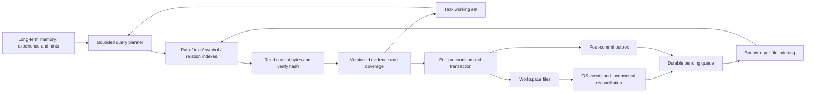

# Versioned code intelligence

Code intelligence is independent of long-term memory. The filesystem is authoritative;
the index is a disposable, versioned projection. Historical architecture knowledge may
suggest paths or symbols but cannot satisfy an edit precondition.

## Usage

```powershell
polaris code build --workspace . --seconds 120
polaris code status --workspace .
polaris code search target_function --kind symbol
polaris code search target_function --kind calls
polaris code reconcile --audit --seconds 120
```

Build/reconcile work is sliced, durable and resumable. Exit code 2 means work remains,
not a successful full scan. Run the same command again to continue. Queries do not
implicitly rebuild the whole index. A cold Agent starts bounded background construction
on first use; legacy searches use the bounded filesystem fallback with an explicit
notice while the catalog is cold. `maintain=false` disables background construction
(indexes are then built only via `polaris code build`); `watch=false` disables only
OS event watching, with periodic reconciliation as the fallback.
Search also returns exit code 2 for incomplete coverage (including unresolved syntactic
relations); consumers should inspect the JSON rather than treating it as a tool failure.

`code_search`, `code_relations`, `code_context` and `code_validate` are deferred tools discoverable with
`tool_search`. `code_search` selects paths, symbols or text; an identifier first tries
symbols and then text under the same budget. Explicit `kind` bypasses classification.
Current task modules are searched first; an exhausted zero-hit candidate scan permits a wider indexed query under
the same budget. Explicit path/modules remain scoped; `expand=true` starts wider.
Coverage lists the actual checked ranges. `code_relations` supports incoming/outgoing syntactic edges and bounded
depth expansion. These candidates are not type-resolved proofs of a complete call graph.

Legacy `glob` keeps newest-first ordering. `search_text` retains substring/regex semantics,
including basename glob filtering. Bounded scans do not interpret `.gitignore`; shared
VCS/cache/dependency exclusions apply at every depth. Build/runtime exclusions use
`[codeintel].exclude_paths`: workspace-relative roots (default `runs`, `memory`, `build`,
`dist`, `env`), so `agent_core/memory` and `src/build` remain searchable. Override the list
for custom generated/runtime locations, or use `[]` when these root names contain source.
The same rules apply to the catalog, cold scans, transaction overlays and change events.
Secrets and redirected paths are
not indexed. Unsupported files/encodings and oversized files are reported as exclusions.

## Implemented capabilities and boundaries

| Capability | Current implementation |
|---|---|
| Inventory | Persistent SQLite file catalog, path/language/module/size/mtime/hash/revision |
| Incremental updates | Durable post-commit outbox, idempotent pending queue, external events |
| Reconciliation | Resumable directory queue; restart redoes only unfinished directories |
| Text | SQLite FTS5 trigram candidate generation, original-content verification |
| Symbols | Python AST functions, classes and assignment targets |
| References | Python syntactic names, calls, imports and inheritance; unresolved by design |
| Package/build facts | Static package.json, pyproject.toml, Cargo.toml and go.mod dependencies |
| Other languages | Path/text retrieval; configured LSP tools remain available |
| Working set | Bounded task-local versioned ranges, module hints, compaction references |
| Versions | SHA-256 of original bytes, worktree identity, index revision |
| Partitioning | Worktree/policy-isolated databases; indexed logical module partitions |
| Cache | Bounded content-addressed line cache; hash verification remains mandatory |
| Semantic embeddings | Intentionally not enabled or implemented in this release |

Modules currently use the first path component (root files belong to `.`). This is a
directory partition, not a claim to resolve every build-system package boundary.
High-precision cross-language graphs, build target resolution, physical module shards,
an independent daemon and selected semantic indexing are subsequent extensions.

### Large-repository rollout status

The first correctness milestone covers relative inventory exclusions, resumable empty
pages, same-line fact pagination, explicit excerpt ranges, structured evidence
compression and task working-set lifecycle. Regression gates are in
`tests/test_codeintel_contracts.py` and `tests/test_code_evidence_compression.py`.

The second milestone adds private immutable source manifests and streaming content
objects shared by revision capture, checkpoints and verification copies. Checkpoints
reference existing snapshots; task-state v4 references its baseline manifest instead
of embedding the full file inventory on every update. Configurable source/store limits
replace the former 20,000-file / 512-MiB whole-repository limits. Strict capture still
hashes all eligible source and checks membership; stat hints never certify completion.
See [snapshot configuration and validation](coding-agent-runtime.md#持久化源码快照与检查点).

The follow-up exploration milestone adds `strategy.py::ExplorationState`: bounded
query fingerprints (including input cursor, scope, kind and relation depth), index
generation, coverage observations and repeated-no-gain advice. Search always executes;
history never proves absence, freshness or permission. Incomplete empty results suggest
continuation/refresh/narrowing, not a confident "not found". Module/checked-scope lists
are bounded and disclose truncation. Raw query strings, cursors and source bodies are
not stored in the history.

`TaskWorkingSet` retains up to 128 evidence references and 64 query records in a
128-KiB versioned task projection. Task-state v5 carries this projection; records bind
to worktree and read policy. Resume filters paths under current permissions and marks
everything `needs_revalidation`; it never repopulates `code_read_versions`. Commits
mark relevant references and query observations stale. `task_state` sections
`code_queries` and `code_evidence` expose bounded pages; compaction preserves a bounded
historical projection. The planner records its search observations and passes strategy
advice with the evidence to its model. This is rule-based guidance, not an automatic
learning planner or a task-level retrieval-success guarantee.

`tests/test_code_exploration.py` covers repeat/continuation distinctions, incomplete
coverage, policy/worktree changes, stale invalidation, bounded UTF-8 state, both
inline and manifest-based v5 baselines, compaction recovery, and an actual ReAct
tool round with persisted run events and transcript records. These deterministic
checks do not measure a real model's strategy selection or task-solving success.

### Candidate records and staged retrieval (S3/S4)

`candidate_pool.py` + `TaskWorkingSet.candidates` merge text/symbol/relation/LSP
evidence into one `CandidateRecord` (schema v1) per normalized identity: role
(target/dependency/test/unknown), bounded evidence refs, supporting/contradicting
notes, and split anchor vs relevance validation. Restored or version-moved
candidates degrade to `needs_revalidation`; committed paths mark them `stale`.
A candidate never grants an edit precondition — `code_validate` stays the gate.
`task_state(section=code_candidates)` pages the pool; conflicts stay visible.

`strategy.py::RetrievalController` routes planner retrieval by query shape
(path-first for explicit paths, symbol→text for identifiers, text for natural
language), dedupes identical in-plan queries, and caps stages. `plan_code_task`
runs every stage under one shared `QueryBudget` (the calling tool's timeout owns
wall time) and records `routing`/`budget` in its result; the plan payload shows a
bounded candidate summary. Stage execution stays in the normal ReAct loop — the
locked planner tool never nests the tool dispatcher, and LSP never bypasses
permissions, hooks, locks or sandboxing. Semantic retrieval remains deferred.

### Structured LSP symbols and bounded call hierarchy (S5)

`document_symbols` gains an explicit `mode="structured"` integration: DocumentSymbol
hierarchies and flat SymbolInformation flatten into versioned candidate evidence
with server-declared UTF-16 ranges, containment/permission checks and a final
source reread. Raw mode is unchanged. Servers that do not declare a capability
return a structured `unavailable` record on strict (evidence) paths; legacy raw
requests pass through. `incoming_calls`/`outgoing_calls` match multiple prepared
items by the position's identifier and return an explicit `ambiguous` payload
instead of silently taking the first. `LSPManager.open_document`/`notify_saved`
accept the caller's budget; the standalone default budget remains for raw callers.

### Static workspace/local-package graph (S6)

`package_links` records per-manifest local edges: npm workspaces and name/path refs,
Cargo workspace members and path dependencies, Go module name matches and local
`replace`, and explicitly scoped Python refs (`tool.uv.sources` / Poetry `path`).
Resolution uses only the indexed `module_roots` inventory (never a filesystem walk):
`local_name`, `local_path`, `workspace_member`, or `unresolved` with an explainable
reason (`ambiguous_local_name:N`, `no_indexed_package_at_path`, `path_escapes_workspace`,
`package_removed`, `package_renamed`). New roots re-resolve pending links and re-queue
affected manifests through the bounded pending path. Query kind `local_dependency`
(incoming/outgoing) shares the cursor, budget and `max_depth`/`max_edges` bounds of
relation expansion; external registry dependencies remain plain manifest edges and
are never reported as local source links. No build/package script is executed.

These milestones do not certify million-line end-to-end coding tasks. LSP location evidence,
static package boundaries and literal/symbol candidate validation are now integrated (see below);
full semantic graphs and measured indexing optimizations remain later work.
Embeddings and physical sharding are optional, subject to measured need.

2026-11-01 adds the first structural-location increment. Symbol hits optionally carry
`symbol` metadata (subrecord schema v1): a definition ID scoped to worktree, file
content hash, qualified name, kind, line range and parser fingerprint, plus container
and explicit syntax precision. Reindexing identical content with the same parser
keeps the ID; edits, movement or parser changes invalidate it. This is not a stable
rename identity or type-resolved target. Relationship targets remain syntactic and
do not receive invented resolved IDs. Task working-set persistence still stores
file/range references; it does not yet persist these symbol IDs.

The index meta record now binds Python AST version/interpreter grammar and manifest
parser version. Missing or changed fingerprints atomically mark files pending and
enqueue bounded rebuilding. Existing queue reasons survive; generation changes
invalidate cursors. An already-open service with a mismatching parser refuses to
publish facts or answer indexed searches. No source is parsed merely to initialize
the database. The SQL table schema and search-page version remain v1 (additive
metadata); mixed writers from old binaries that predate this protocol are unsupported.

The offline [real-task evaluation baseline](repository-task-evaluation.md) separates
retrieval, patch application, local tests and reported hidden-test resolution. Real
repository/model execution is pending; the current increments do not close that gate.



## Contracts

Persisted code schema is version 1. The change outbox is format 2 (normalized per-path
rows with a consumption cursor); legacy format-1 JSON events remain readable and are
migrated on replay. Existing Message and ToolResult contracts remain unchanged. New
fields are carried in namespaced metadata, with visible coverage/version details in the
new code-tool result body.

`SearchPage` contains hits, generation, cursor, usage and `SearchCoverage`. Every code
hit has path, range, original-byte hash, worktree ID and revision. Path-only hits have
no fabricated code range. A cursor binds the query and index generation; if the
generation moves mid-pagination (any indexed change), the query returns an empty page
with a `generation_changed` coverage reason instead of an error — restart without the
cursor. Line numbers are one-based.

Cursor format v2 tracks scan progress independently of returned hits. Empty partial
pages may carry a cursor: continue until there is no cursor, checking coverage on every
page. Stable fact positions preserve multiple relations on the same source line. A
cursor also binds the store and resolved search strategy/scope; growth of the task
working set does not narrow an in-flight query. Old-format cursors must be restarted.
When no progress is possible (for example, the first hit cannot fit the output budget),
the page has no cursor and an explicit `no_scan_progress` reason; narrow the query or
increase the exhausted budget instead of repeating it unchanged. `scan_complete` means
the selected indexed candidates were exhausted; it does not override coverage gaps.
Budget-interrupted symbol scans do not silently fall back to text or expand their scope.
Unindexable files elsewhere do not disable useful text fallback, but their coverage
warnings survive fallback and scope expansion.

`start_line`/`end_line` describe a source fact's extent. `excerpt_start_line` and
`excerpt_end_line` identify the lines actually present in `text`; a symbol result may
show only the first 11 lines of a longer definition. `truncated` and `next_start_line`
make the omission explicit. Continue with `code_context(path, start=next_start_line,
expected_version=version)` and a suitable limit. Region reads contain source lines only,
never a truncation marker masquerading as a source line. Empty/out-of-range reads have
null ranges; bounded region reads indicate whether further file lines remain.

Conversation compression keeps complete JSON records or versioned references. It marks
coverage incomplete, counts omitted hits, and exposes `recovery` with the original page
request (or an instruction to repeat that tool call when the budget is very small).
A compressed page clears its next-page cursor: advancing that cursor would skip hits
removed by compression. Retained references can be reread with `code_context` and their
expected versions. Spilled output is not reconstructed from hidden metadata. Normal
output hooks and generic tool-result compression remain in effect.

`coverage.complete` is relative to the requested **indexed observation**, not an atomic
snapshot of a live filesystem. `freshness` explicitly describes this distinction.
Watcher lag, pending changes, incomplete discovery, excluded files, unsupported
structure and exhausted budgets prevent whole-repository conclusions. A no-match
result is never evidence of absence in unexamined modules. Precision disclosures
(e.g. `python_syntax_only`) live in `coverage.advisories` and never affect
`complete`; completeness is about coverage, not about syntactic precision.

File reads verify size, identity and timestamps around bounded byte reads. The content
hash and parsed evidence refer to those bytes. A slow index task cannot overwrite a
newer pending event; text/symbols/edges publish together in one SQLite transaction.
Changed content is hash-verified again before being returned. Even a timestamp-preserving
edit invalidates the old hit; periodic hash audits discover missed changes.

## Edit safety and transaction projection

`read_text_file` returns `file_version`. `edit_file`, `multi_edit` and `write_text_file`
accept `expected_version`; `apply_patch` accepts an `expected_versions` map. Agent
execution also binds the latest verified read version without requiring the model to
copy the hash. Changed files raise `StaleEvidence`; the Agent must reread and reconsider.
`strict_versions=true` requires such evidence before editing existing ordinary files.
Creation can express `{"exists": false}`. Legacy direct callers can omit versions while
strict mode is off. Notebook's existing verified-read behavior remains intact.

The executor still enforces transaction resource dependencies and commit-time hashes.
`ResourceLock.materialize=false` is used only by audited query tools: queries merge
original files and the current overlay without recursively copying a directory. Actual
read hashes and observed directory membership fingerprints are validated on commit.
Membership fingerprints exist to catch "a file appeared/disappeared in a directory my
listing claimed to enumerate"; content edits to existing files are covered by the
per-read hashes instead. External churn inside a scanned directory therefore fails the
turn loudly (the write is rolled back and retried by the loop), which is deliberate:
listing evidence must describe the tree the commit lands on. Writes remain confined to
declared write resources. Rollback does not publish the overlay
to the shared code index. The original recovery journal stays authoritative; the code
outbox is an additional replayable projection. Index failures after commit are observable
and do not retroactively turn a successful filesystem commit into a rollback.

These checks coordinate internal writers and detect observed external changes. Ordinary
filesystems do not provide a general atomic multi-file compare-and-swap against arbitrary
external writers. Tasks requiring a globally immutable view should analyze a fixed Git
commit/worktree snapshot rather than claim that a live watcher provides that guarantee.

## Maintenance, permissions and lifecycle

The default directory is `$POLARIS_HOME/codeintel/<worktree-id>/` (otherwise
`~/.polaris/codeintel/`). It is separate from memory indexes and contains only rebuildable
code data. Policies with restricted reads use separate index files; the actual result
path is checked again against current read restrictions. No repository-provided parser,
build script, package manager or executable is run by indexing.

Install the `codeintel` extra for watchdog OS events. Without it, status explicitly says
`periodic_reconciliation_only`. OS watches are capped at 512 directories; reconciliation
also covers unwatched directories, event overflow, lost events and offline edits.
Hourly-or-slower hash auditing is incremental, and budgets prevent a single pass from
monopolizing resources. IDE unsaved buffers are not part of the disk view.

Agents on the same event loop, worktree, config and permission policy share maintenance
and a ref-counted service. Cross-process writers use a file lock; readers use SQLite WAL.
Starting a new task recreates its working set even when the index service is reused.
Changing config, workspace or read policy rebinds the service and clears active evidence.
Non-default exclusion lists use separate cache files. Old inventories missing the new
policy fingerprint become incomplete and reconcile once before claiming full coverage;
the persisted fact schema remains v1.
Resume and worktree changes release the old service and clear active evidence. Long-term
memory can be disabled without disabling any of this functionality.

Normal application uninstall retains this independent cache with other user data;
the existing `--purge-data` removes the default `~/.polaris` tree. A custom
`POLARIS_HOME` remains under its owner's lifecycle. No automatic recursive deletion of
custom paths is introduced. Index/schema upgrades should rebuild into a fresh directory
after closing users of the old service, rather than mutate memory or recovery journals.

## Resource limits and performance

`[codeintel]` controls deadlines, files, bytes, per-file bytes, candidates, results,
context tokens, graph depth/edges, module fan-out, cache entries and index disk quota.
One budget covers all stages and fallbacks. SQL has a progress interrupt; regex runs in
one killable subprocess per query (all candidates are framed through a single bounded
pipe, never one process per file). Cancellation reaps query subprocesses and
cooperative workers. Output uses a conservative UTF-8 byte bound
for evidence (including serialized hit hashes/paths); the small coverage envelope is
additional. Legacy file reads have an additional 16 MiB ceiling. Per-file parsing and
SQLite transaction commit are cooperative boundaries, not forcibly preempted operations.
The disk quota includes WAL and is checked between bounded slices; one slice may overshoot.

Indexing commits in bounded chunks (128 files) within a bounded time slice, so writers
never hold the SQLite write lock long enough to fail concurrent queries; a busy writer
defers a query's outbox replay instead of erroring (coverage reports
`commit_replay_deferred`). A retained connection avoids checkpointing WAL after every
file. Symbols have indexes on name, qualified name and
file owner, so updating one file does not scan every symbol. The code-layer cache does
not suppress content validation. Physical shards should be introduced based on measured
write pressure and index size, without changing the public query contracts.

## Delivery stages and compatibility

| Stage | Files/modules and contracts | Status |
|---|---|---|
| 0. Budgets and boundaries | `codeintel/config.py`, `budget.py`, `models.py`; `QueryBudget`, `FileVersion`, `SearchPage`; existing `ExecutionScope` | Implemented, required |
| 1. Inventory and change tracking | `store.py`, `catalog.py`, `indexer.py`, `changes.py`, `watcher.py`; file/pending/directory queues, commit sequence, schema v1 | Implemented, required |
| 2. Structured retrieval | `backends.py`, `service.py`, `cache.py`; `SearchRequest`, atomic per-file symbol/edge ownership, logical module scope | Implemented for Python/static manifests; path/text for other languages |
| 3. Agent integration | `tools/codeintel.py`, `tools/base.py`, `tools/registry.py`, `runtime.py`, `working_set.py`, `react.py`, `session.py`, `worktree.py`; task ranges and reference-counted service | Implemented, required |
| 4. Edit/transaction consistency | `snapshots.py`, `tools/builtin.py`, `tools/editing.py`, `tools/executor.py`, `tools/transaction.py`, `lsp.py`; expected versions, query overlay and post-commit outbox | Implemented, required |
| 5. Operations and validation | `cli.py`, `config.py`, `health.py`, configuration example, `tests/test_codeintel.py`, `benchmarks/codeintel.py`; status/build/reconcile/search | Implemented; workload-specific capacity tuning remains necessary |
| 6. Advanced acceleration | Type-resolved multi-language backends, physical shards/daemon, query-plan cache, build-system module boundaries and selective semantic vectors | Deferred optimizations |

The required compatibility changes are explicit: searches may return fewer results
with partial coverage; UTF-8/size/exclusion limits can omit previously scanned files;
stale read-to-edit evidence now rejects a write. `expected_version` fields are optional
for legacy direct callers, and strict mode is opt-in. Disabling `[codeintel].enabled`
removes the whole layer from the agent loop: the `code_*` tools are unregistered,
`read_text_file` issues no version metadata, searches keep the bounded filesystem
scan, no working set or post-compaction reference list is produced, and executor
version binding stays off. Explicitly caller-supplied `expected_version` arguments are
still honored — disabling never silently accepts a stale-write guard the caller asked
for. Ordinary public tool names and `ToolResult` serialization stay compatible.
Existing memory files, transcript schemas and recovery journal states do not require
migration.

The current implementation is an in-process service with a separate store and API.
Physical module sharding is not needed to validate this boundary; it remains a response
to measured write contention or index size. Full call-graph correctness, workspace-wide
LSP result federation remain later work. Persistent task work-set restore is supported
as historical references only. LSP location evidence and static package boundaries now have
a first implementation. The next stage is measured index-maintenance/concurrency improvements;
embedding and physical sharding remain optional. Real large-repository coding-task
acceptance is still required separately from the synthetic capacity benchmarks.

## Validation commands

```powershell
.venv/Scripts/python.exe -m pytest -q tests/test_codeintel.py
.venv/Scripts/python.exe -m pytest -q tests/test_codeintel_contracts.py tests/test_code_evidence_compression.py tests/test_compression.py tests/test_editing.py
.venv/Scripts/python.exe benchmarks/codeintel.py --lines 10000000 --samples 20 --output deliverables/codeintel-10m.json
.venv/Scripts/python.exe -m ruff check agent_core tests installer
.venv/Scripts/python.exe -m mypy
```

The benchmark creates 32 modules of Python source, includes a complete cold build,
repeated module queries and a single-file update. Its generated functions/assignments
are a reproducible synthetic scale check, not a substitute for a heterogeneous real
monorepo or a promise of universal latency. Limits should be calibrated on deployment
hardware; the artifact records corpus shape, platform, configuration and query coverage.


## LSP 位置证据、包边界与修改候选（2026-11-01）

开启 code intelligence 时，`lsp` 的 `definition`、`references`、`implementation`
返回统一 SearchPage：每条位置附带当前允许读取的源码、FileVersion、行范围与
`precision=lsp_reported_location`。支持 Location/LocationLink；拒绝外部路径、非本地 file URI、
越界及切开 UTF-16 代理对的位置。客户端仅协商 UTF-16。查询共享 deadline/读取/输出预算；
结束前复读来源及已见目标检查版本。超过预算的部分结果只是线索。

结果可进入工作集及结构化上下文压缩，但不会直接建立编辑版本凭证。覆盖始终声明
`lsp_server_coverage_unknown`：源码哈希新鲜不等于语言服务器的全局依赖索引新鲜。
hover、diagnostics、workspace/document symbols 和调用层级暂保留原接口；未实现全语言类型图，
未配置服务器时仍使用文本/AST 检索。规划器会提示在歧义位置显式调用 LSP，尚不自动选择 LSP 查询坐标。

索引维护识别有名字的 Python（project/Poetry）、npm、Cargo 包清单和 Go module 声明，
将文件归入最近的包根目录（module 值仍为仓库相对路径，不是包名），缺少清单时退回首层目录。
`module_roots` 保存清单路径、根目录、名称和内容哈希；不执行构建脚本，不展开 workspace glob，
不把这层包边界当作完整构建目标图。嵌套清单增加、删除或失效时，受影响子树原子进入 pending，
由现有有界维护队列重新提取；查询不会全仓重建。根目录边界改变可能使全仓待更新，成本需计入增量测试。
新增规则已进入 parser fingerprint，旧索引首次打开会重新排队。

修改前的推荐流程：检索候选 → 明确直接目标/依赖/测试 → code_context 读取 →
`code_validate(path, expected_version, anchor, symbol?)` → 携带版本约束局部编辑 → diff/针对性检查。
code_validate 要求 worktree/path/hash 全部匹配、非空文本锚点在文件中唯一（含重叠匹配），
可选 symbol 必须是当前 Python 解析得到的身份且包含锚点。它返回版本、行范围、锚点哈希；
不声称候选符合需求，也不替代编辑时的再次校验和行为测试。其他语言先使用精确文本锚点。
工具默认延迟加载，code intelligence 关闭时一起禁用，现有工具参数保持兼容。

离线测试：`tests/test_structural_evidence.py`，覆盖权限过滤、移动版本、UTF-16、
嵌套包删除/失效、候选歧义和符号归属。真实语言服务器的大仓正确率/延迟尚待外部环境验收。


## 索引维护与并发资源（2026-11-02）

维护复用现有 SQLite/WAL、pending 队列和目录游标。`ensure_index` 默认使用
`maintenance_seconds=0.25` 的软切片和 `maintenance_files=128` 文件上限；原有
query_seconds/max_files/父任务 deadline 更小的限制仍生效。锁等待占用本次预算并支持取消。
软切片在文件之间检查，已准入的单文件可在 query_seconds/父 deadline 内完成，避免解析较慢文件
在每个短切片末尾反复被丢弃。AST 解析和部分 SQLite 调用是同步操作，预算不是抢占式硬实时保证。
调用方应循环到 catalog_complete、pending=0 且 replay_pending=false；CLI 已更新，单次 ensure_index
不再保证处理完整个小仓库。返回 maintenance.processed_files/unchanged_files 和 stop_reason 供诊断。

低频 audit 仍完整读取并 hash 文件。仅当 pending 原因是 audit、原状态 ready/text_only、
内容 hash 与当前 parser fingerprint 一致且 pending reason 未改变时，保留原 facts/revision，
只更新 stat 并移除队列项；变化文件、策略过滤、模块改变、解析器升级和其他事件仍走提取流程。
这减少 AST/FTS 重建，不取消源码新鲜度校验。

transaction outbox 按事件上限重放，且单个事件内部以有界路径批次（默认 256 条）逐批提交：
每批在同一事务中重读消费游标、写入 pending 并推进游标；取消、deadline 或异常只回滚在途批次，
已提交批次保留，下次从记录的 ordinal 恢复，事件在全部路径完成后才写入 dedupe 行。
v2 outbox 为每条路径保存规范化行；旧的单条巨型 JSON 事件先做大小检查，再经 SQLite json_each
单趟流式拆分迁移（超过 64 MiB 或格式不支持时报告 unsupported diagnostic，不悄悄 advance 或 skip）。
查询有剩余事件或路径时报告 commit_replay_pending，无法重放时报告 commit_replay_deferred，
均不能声称完整覆盖。

`max_concurrent_requests=4` 限制每个共享 service 提交给线程池的工作数；等待准入消耗原预算，
取消会移除等待者。状态、查询、发布和维护均被跟踪。关闭时先拒绝新请求，再等待后台任务及在途
文件/SQLite 工作结束，最后关闭目录游标和数据库。重复取消仍等待真实线程结束，不提前释放槽位。
此上限按 service 生效，不是跨工作区的全进程并发优先级调度。

后台维护和 CLI 构建循环使用 detailed=false，省去每个切片的 files/state/module 完整统计；
只查询目录状态、pending 数与 generation。显式 status 及默认详细 ensure_index 保留完整统计。
文件监听事件保留至发布成功，按版本令牌确认，每批最多 256 路径、队列最多 10,000 路径；
失败/取消保留事件，更新中的路径不会被旧确认抹去，溢出或目录事件触发重新盘点。

离线回归见 tests/test_codeintel_maintenance.py 和 tests/test_codeintel_watcher.py。
`benchmarks/codeintel_maintenance.py --files 128 --lines-per-file 200 --samples 10 --output tmp/maintenance.json`
生成临时合成仓库，测构建、未变化审计、单文件更新与维护期间查询，并断言检索答案；报告含
provenance（源 SHA、配置 hash、工作树脏标记）、每阶段 tracemalloc 峰值内存与索引磁盘字节。
默认配额为 2–20,000 文件且不超过 2M 初始行；`--allow-large` 显式扩展到 60,000 文件 / 12M 行
（S7 高文件数压力矩阵用）。规模矩阵（1M/10M LOC、>20k 文件、重复/唯一/混合内容、深层模块、
多语言清单、变更/删除/时间戳保持、并发查询、publish burst、取消/恢复、受限读策略）由
`benchmarks/codeintel_scale.py` 执行，每 cell 至少 50 个查询样本与 1–5 次独立重建。
前后报告见 [`codeintel-maintenance-report.json`](../benchmarks/codeintel-maintenance-report.json)。
计时为同机单轮小样本，真实百万/千万 LOC 与超过 20,000 文件的开发任务验收仍待真实仓库和模型环境。


本机对照（128 个 Python 文件 × 200 行，每类查询/增量 10 个样本）：
未变化 audit 从 0.945 s 到 0.295 s，AST 调用从 128 次到 0 次；首次构建
2.840 s 到 1.941 s，解析仍为 128 次。单文件更新 P95 为 65.264/59.217 ms。
维护中查询 P95 为 26.036/25.695 ms，P50 从 11.360 ms 上升到 18.236 ms，
这组样本未证明并发查询变快。准入、让出机会和关闭清理的正确性由确定性回归检查。
两批相关回归分别 98 项和 113 项通过（包含重叠用例），Ruff 与 Mypy（223 个生产模块）通过。
普通受限 Windows 环境无法初始化 asyncio Proactor socketpair，离线基准及 async 回归在自动审核允许的
正常 Windows 进程中运行；没有启用真实模型或外部服务。

## S7 规模矩阵实测（2026-11-03，本机 Windows 11 / 16 核，工作树含 S1–S6 改动）

合成语料、种子 7、每 cell 3 次独立重建、51 个查询样本；原始数据与 provenance
（源 SHA `a946482c`、配置 hash、环境指纹）见 `deliverables/codeintel-scale-*.json`、
`deliverables/codeintel-10m.json`、`deliverables/codeintel-maintenance-21k.json`。

| cell | 构建(秒, 3 次) | 符号 recall@20 | 符号 recall（翻页） | 文本 recall@20 | 符号 P95 |
|---|---|---|---|---|---|
| 1M / 1,000 文件 | 216/210/224 | 1.0 | 1.0 | 1.0 | 14 ms |
| 1M / 重复符号名 | 225/219/213 | 0.80 | 1.0 | 0.75 | 156 ms |
| 1M / 受限读策略 | 217/228/225 | 1.0 | 1.0 | 1.0 | 14 ms |
| 1M / 21,000 文件 | 558/543/574 | 1.0 | 1.0 | 1.0 | 23 ms |
| 10M / 10,000 文件 | 2659/2542/2539 | 1.0 | 1.0 | 1.0 | 20 ms |
| 10M / 21,000 文件 | 2423/2334/2306 | 1.0 | 1.0 | 1.0 | 28 ms |

10M 平面基准：构建 2293 s，索引 1.49 GB，符号 P50/P95 = 16.9/22.2 ms，文本 P95 = 412 ms，
构建期 Python 峰值分配 23 MB。21k 文件维护基准：构建 484 s，未变化 audit 97 s（0 次 AST 重解析），
单文件增量 P95 87 ms，维护期查询 P95 36 ms，索引 201 MB。

重复符号 cell 的 recall@20=0.8 是单页 8000 字节输出预算的截断视图；翻页后全部找回
（recall_retrieved=1.0）。增量、删除、时间戳保持改写、publish burst、维护期并发查询、
取消后恢复、关闭重开 resume 均在每个 cell 内执行成功；no-match 查询零误中。
这些是同机合成语料实测值，不是真实仓库/真实模型的任务解决率；token、工具/LLM 调用、
patch 成功率与隐藏测试通过率在离线环境不可测，按 null 记录。实测未显示需要
embedding/rerank、物理分片或常驻 daemon 的证据（S9 不启动）。
